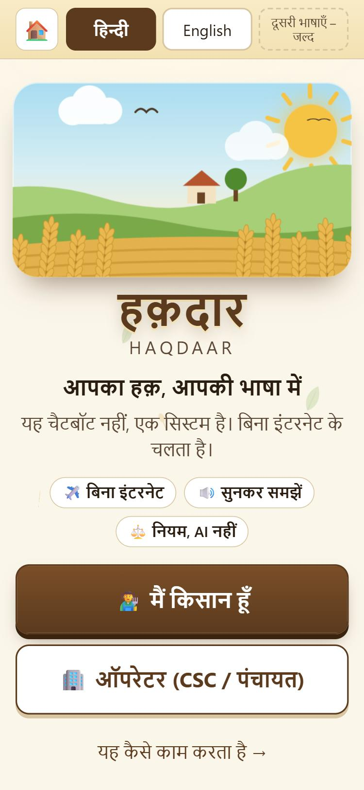
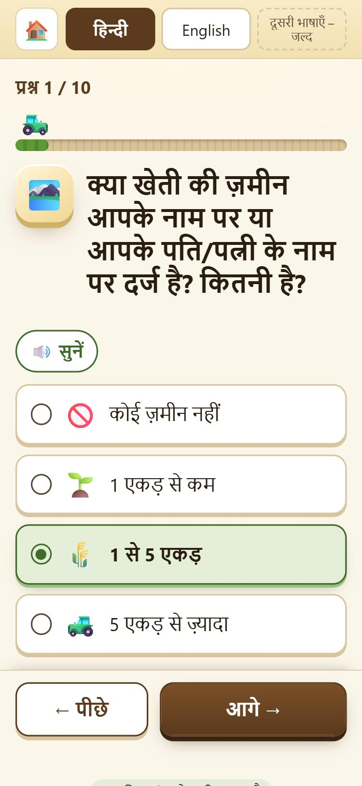
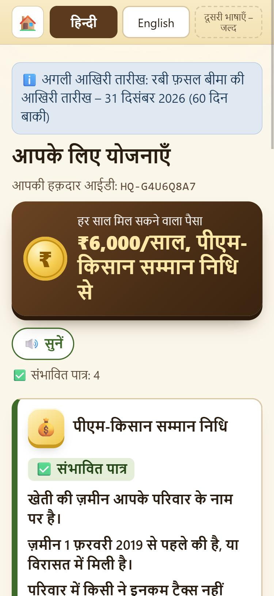
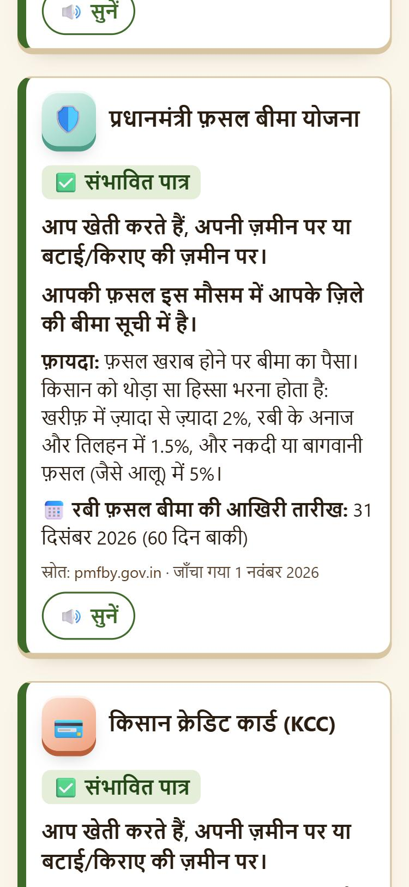
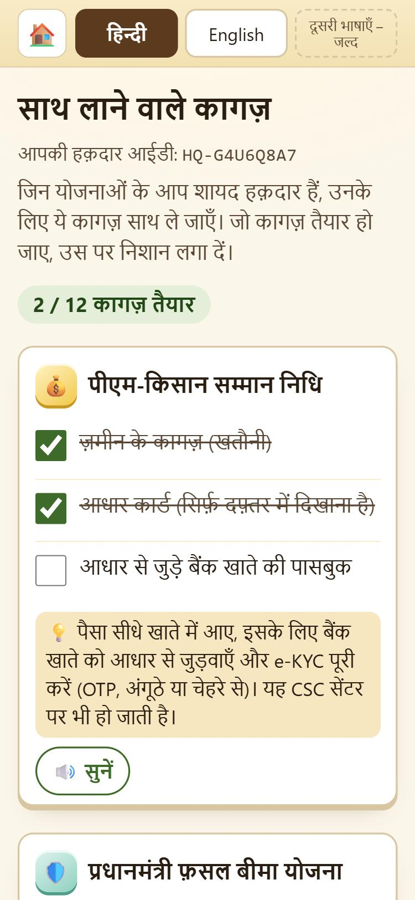
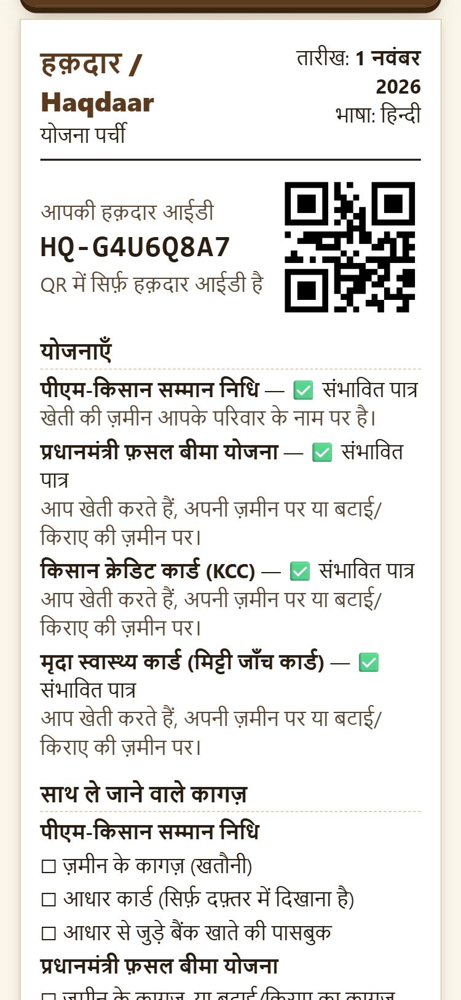
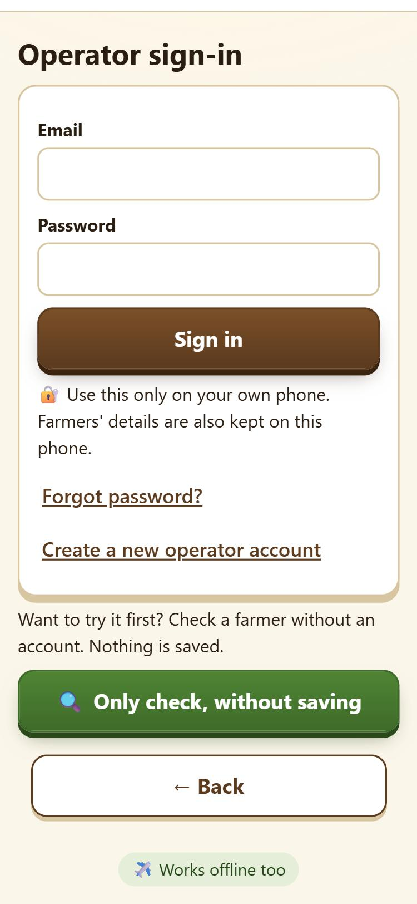
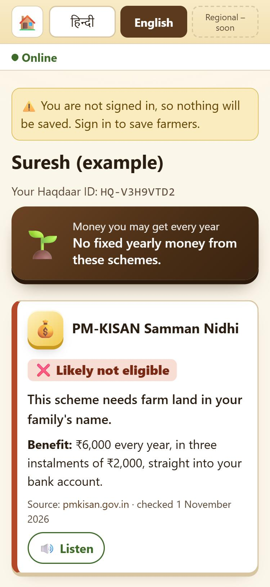
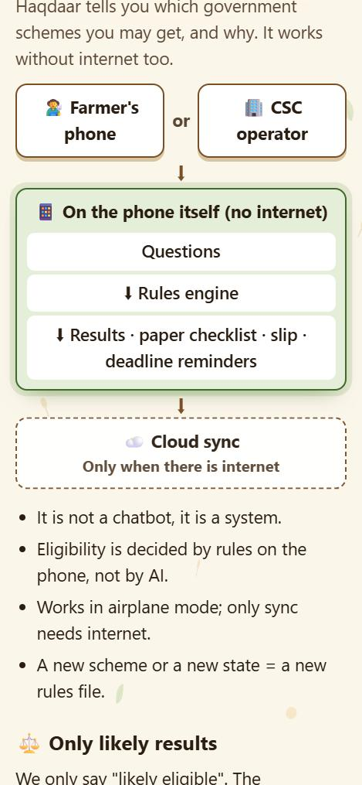

# Haqdaar (हक़दार)

**Which government schemes a farmer may get, and why. Works without internet.**

**Team Root Access** · Catalyst Hack 2026 · Track 07: AgriTech & Rural Innovation

**Built by Team Root Access:** Chaarvi Saxena, Yashi Savita, Vivek Singh, Ishan Singh Bhadoria, Divyanshu Tripathi

| | |
|---|---|
| **Live app** | **https://haqdaar-one.vercel.app/** |
| **Source code** | https://github.com/chaarvisaxenagit/haqdaar |
| **Try it with no account** | Open the live app → **Operator (CSC / Panchayat)** → **Only check, without saving** |

---

## Contents

1. [Problem statement](#1-problem-statement)
2. [Project overview](#2-project-overview)
3. [Screenshots](#3-screenshots)
4. [Key features](#4-key-features)
5. [Technology stack](#5-technology-stack)
6. [Implementation details](#6-implementation-details)
7. [Deployment and live link](#7-deployment-and-live-link)
8. [Setup (for developers)](#8-setup-for-developers)
9. [How to use Haqdaar](#9-how-to-use-haqdaar)
10. [What works offline](#10-what-works-offline)
11. [Languages](#11-languages)
12. [Privacy and security](#12-privacy-and-security)
13. [Schemes and sources](#13-schemes-and-sources)
14. [Testing](#14-testing)
15. [Project structure](#15-project-structure)
16. [Honest limits](#16-honest-limits)

---

## 1. Problem statement

**Official problem statement:**

> India’s farmer schemes and crop insurance reach only those who know they exist, understand if they qualify, and finish the paperwork on time. Small and marginal farmers miss out at every step: information is mostly in formal Hindi or English, eligibility rules are scattered across separate portals, applications get rejected over missing documents, and insurance deadlines pass unnoticed. Most digital tools make this worse because they assume a smartphone, steady internet and digital skills, which many farmers don’t have. Farmers end up paying middlemen for information that should be free. We need a native-language system that works fully offline. It should tell every farmer which schemes they likely qualify for and why, which documents to bring, and when each deadline falls. Farmers can use it themselves on a phone or get the same help through a CSC or gram panchayat operator.

**How Haqdaar answers each part of it:**

| The problem statement asks for | What Haqdaar does |
|---|---|
| A native-language system | Simple village Hindi first, plus English; a Listen button reads every question and result aloud. More Indian languages plug in as one folder each. |
| Works fully offline | After one visit, everything works in airplane mode. Only operator sync needs internet. |
| Which schemes they likely qualify for, and why | Results say "likely eligible", "likely not eligible", "ask the agriculture office" or "already have it", and every result shows its reason. |
| Which documents to bring | A checklist of papers per scheme, also printed on the slip. |
| When each deadline falls | Deadline dates on every result, an alert for any last date in the next 30 days, and an operator follow-up list for the next 14 days. |
| Farmers use it themselves on a phone | Farmer mode: no sign-in, data stays on the phone. |
| Or get the same help through a CSC or gram panchayat operator | Operator mode: the same questions and results, with consent, a printed slip and follow-up, for farmers without a smartphone. |
| Information should be free, not bought from middlemen | Every slip says "This help is free. Do not pay anyone for this information." |
| Applications rejected over missing documents | Tips to fix problems before applying (for example, link Aadhaar to the bank and finish e-KYC), and tick boxes for papers. |

**Numbers behind the problem:**

| Fact | Number | Source |
|---|---|---|
| Agricultural households with a valid Kisan Credit Card | 44% | NABARD NAFIS 2021-22 |
| Paddy / wheat households insured | ~8% / ~7%; over 60% did not know about crop insurance or where to get it | NSS SAS 2019, via FAS |
| Rural women who never used the internet | ~4 in 10 | NFHS-6, 2023-24 |
| Internet subscriptions per 100 people | 49 rural vs 129 urban | TRAI, Jun 2026 |
| One PM-KISAN instalment (23rd) | about ₹18,880 crore to 9.44 crore farmers | PIB, Jun 2026 |
| Functional Common Service Centres (CSCs) | ≈5.7 lakh, of which 4.48 lakh are in rural areas | csc.gov.in, Oct 2026 |
| Hindi as mother tongue | 43.63% of Indians | Census 2011 |

**The gap:** an eligibility checker that needs internet, a smartphone and good reading skills misses the farmers who need help most.

## 2. Project overview

Haqdaar tells a farmer which government schemes they are **likely** eligible for, **why**, which papers to bring, and when each deadline falls. It works fully offline, in Hindi and English.

**A system, not a chatbot.** Fixed rules on the phone decide each result, and every result shows its reason. The farmer gets a paper slip, and the operator gets a follow-up list so nobody misses a deadline. No AI decides eligibility, so the same answers always give the same result.

It has two modes in one app:

- **Farmer mode:** the farmer uses their own phone. No sign-in. Their answers stay on the phone and never leave it.
- **Operator mode:** a CSC operator, gram panchayat worker or agriculture worker signs in, registers the farmer with consent, asks the same questions, prints a slip and follows up before deadlines. **This is how Haqdaar reaches farmers who have no smartphone.** Records save offline and sync when the internet comes back.

**How Haqdaar differs from online checkers** such as Bharat-VISTAAR (155261) and myScheme: it works offline, gives a reason for every result, prints a plan on paper, and reminds the operator before deadlines.

**Prototype scope:** 4 central schemes (PM-KISAN, PM Fasal Bima Yojana, Kisan Credit Card, Soil Health Card), demo district Lucknow (Uttar Pradesh), languages Hindi and English.

## 3. Screenshots

All screenshots were taken from the live app (https://haqdaar-one.vercel.app/) on 1 Nov 2026, at phone width. The farmers shown are fictional examples.

| Start page (Hindi) | One question per screen | Results with money card |
|:---:|:---:|:---:|
|  |  |  |
| **A scheme card: status, reasons, benefit, deadline, source** | **Checklist of papers to bring** | **Printable slip with QR code** |
|  |  |  |
| **Operator sign-in** | **Operator "Check only", in English** | **How it works / About** |
|  |  |  |

## 4. Key features

**For the farmer**
- One question per screen (10 screens; 9 if the farmer has no land), big buttons with pictures. No typing.
- **Listen** button on every question and result card (the phone's own read-aloud voice).
- Result for each scheme: ✅ likely eligible, ❌ likely not eligible, ❓ ask the agriculture office, or ☑️ already have it. **Every result shows its reason.**
- Yearly money card (for example ₹6,000/year from PM-KISAN).
- Tips to fix problems (for example "link Aadhaar to your bank and finish e-KYC").
- Checklist of papers to bring, with tick boxes.
- Deadline alert for any last date in the next 30 days.
- Printable slip with the Haqdaar ID and a QR code.
- "Delete my data" removes everything from the phone.

**For the operator (CSC / panchayat / agriculture worker)**
- Own account, with consent taken before any farmer is saved.
- Register a farmer: consent → name and village → the same questions → saved.
- Farmer list with search (by Haqdaar ID, name or village).
- **Follow-up list:** farmers with a deadline in the next 14 days who have not applied yet, or whose follow-up date has come.
- Application status per scheme (not started, papers ready, applied, approved, rejected) and a follow-up date.
- Edit answers or details, print the slip, or delete a record if the farmer withdraws consent.
- Top bar shows online/offline and how many records are still waiting to sync.
- **"Check only" mode:** check a farmer and print a slip with no account (nothing is saved). It also opens by itself when an operator is signed out and has no internet.

**For everyone**
- Works in airplane mode after the first visit.
- Hindi and English, switchable on every page.
- Each result links to the official scheme website and shows the date we last checked it.

## 5. Technology stack

| Layer | What we use | Why |
|---|---|---|
| App | Vite + React + TypeScript | One fast static app, no server code |
| Styling | Tailwind CSS + our own CSS | Phone-first layout; system fonts only, so every Indian script shows offline |
| Pages | `react-router-dom` with HashRouter | Addresses like `/#/f/results` never give a "page not found" on refresh |
| Offline + install | `vite-plugin-pwa` (Workbox service worker) | Saves the whole app on the phone on the first visit |
| Rules engine | Our own TypeScript code + `schemes.json` | Rules are data; no AI decides eligibility |
| Languages | JSON text files + a small React context | No translation library needed |
| Read aloud | Browser `speechSynthesis` | Built into the phone; works offline if the voice is installed |
| Farmer-mode storage | `localStorage` | Data never leaves the phone |
| Operator data + sync | Firebase Firestore with persistent offline cache | Saves offline, syncs when online |
| Operator sign-in | Firebase Authentication (email + password, confirmed email) | Each operator has their own account |
| QR code | `qrcode` | Made on the phone, offline |
| Tests | Vitest | Rules engine, translations and email checks |
| Hosting | Vercel (HTTPS), code on GitHub | Every push to `main` deploys automatically |

**Libraries and exact versions** (installed on 1 Nov 2026; Node.js 24):

| Library | Version | Used for |
|---|---|---|
| react, react-dom | 19.3.1 | Screens |
| react-router-dom | 7.18.5 | Pages (HashRouter) |
| firebase | 13.1.0 | Operator sign-in, offline database and sync |
| qrcode | 1.5.4 | QR code on the slip |
| vite | 8.3.5 | Build tool |
| @vitejs/plugin-react | 6.1.2 | React support for Vite |
| typescript | 7.0.2 | Type checking |
| tailwindcss, @tailwindcss/vite | 4.3.3 | Styling |
| vite-plugin-pwa | 2.0.0 | Offline install (service worker) |
| vitest | 5.0.5 | Tests |
| @types/qrcode, @types/react, @types/react-dom, @types/node | 1.5.6, 19.3.0, 19.3.0, 24.19.2 | TypeScript types |

No PDF library is used. The slip is a normal page printed with the browser's Print / Save as PDF, so Hindi prints correctly.

No code was written before 1 Nov 2026. All the code was written from scratch during the Grand Finale on 1 Nov 2026.

## 6. Implementation details

### 6.1 Architecture

```
┌──────────────────── On the phone (works with no internet) ────────────────────┐
│                                                                               │
│  Questions ──► Rules engine (schemes.json) ──► Results with reasons           │
│  (one per screen,      no AI, same answer          · paper checklist          │
│   Listen button)       every time                  · printable slip + QR      │
│                                                    · deadline reminders       │
│                                                                               │
│  Farmer mode  ──► localStorage (never leaves the phone)                       │
│  Operator mode ──► Firestore offline cache ──► sync queue                     │
└───────────────────────────────────────┬───────────────────────────────────────┘
                                        │ only when internet returns
                                        ▼
                    ┌──────────── Cloud ────────────┐
                    │  Firebase Firestore           │
                    │  (each operator sees only     │
                    │   their own farmers)          │
                    │  Firebase Auth (operators)    │
                    └───────────────────────────────┘
```

- **One static web app.** There is no server code of our own. Vercel serves the built files; Firebase stores operator records.
- **Farmer mode never loads Firebase.** The operator screens are loaded only when an operator page opens (they are still saved for offline use).

### 6.2 The rules engine (`src/engine/`)

1. **Questions → answers.** Up to 10 screens collect: land, land received after 1 Feb 2019, tenant/sharecropper, income tax, pension or government job, professional or elected post, bank–Aadhaar link and e-KYC, season and crop, Kisan Credit Card, last soil test.
2. **Answers → facts** (`facts.ts`): `ownsLand`, `cultivates` (owns land or farms someone else's land), `cropNotified` (crop is on the district's insurance list for that season).
3. **Facts → result** (`evaluate.ts`). Each scheme in `schemes.json` has conditions such as `{ field: "incomeTax", op: "notEquals", value: "yes", failAs: "not_eligible" }`. Every condition is checked, then:
   - any failed condition marked `not_eligible` → **likely not eligible** (a firm "no" always wins);
   - else, if the scheme's "already have" check passes → **already have it**;
   - else, any failed condition marked `check_office` → **ask the agriculture office**;
   - else → **likely eligible**, with every reason it passed.
4. **The engine returns only text keys**, never sentences, so the same result shows correctly in every language.
5. **Results are never stored.** They are worked out again from the answers each time, so a rules update also fixes old records.
6. **Rules are data.** Adding a scheme or a district means a new entry in `schemes.json`, not new code.

### 6.3 Deadlines and follow-up (`src/engine/deadlines.ts`)

- Each deadline is a month and day (PMFBY: Rabi 31 Dec, Kharif 31 Jul). The engine finds the next date on or after today. Season deadlines count only for the season the farmer chose.
- **Farmer alert:** every deadline in the next 30 days for schemes that are likely eligible or "ask the office".
- **Operator follow-up list:** a farmer appears if a scheme that is likely eligible or "ask the office" has a deadline in the next 14 days and the farmer has not applied yet, or if their follow-up date has come. Soonest first.
- **Suggested follow-up date:** 14 days before the farmer's soonest deadline (or today if that has passed). The operator can change it.
- The engine never reads the clock; "today" is passed in, so tests always give the same answer.

### 6.4 Offline and sync

- **Service worker** (`vite-plugin-pwa`, auto-update) saves every built file on the first visit. Translation files and `schemes.json` are bundled into the app, so they work offline too.
- **Firestore persistent local cache** stores operator records on the phone. Writes are never awaited, so the screen never freezes offline; Firestore sends them when the internet returns.
- **Live listeners** show the farmer list from the local cache while offline.
- **Pending-sync count** = records with changes not yet confirmed by the server. It falls to zero after sync.
- **Never written while signed out:** a write without a signed-in operator is refused on the phone, and the saving screens open only for operators with a confirmed email. So no change is rejected by the server later and lost.

### 6.5 The Haqdaar ID and the slip

- **Haqdaar ID:** `HQ-` + 8 characters from `23456789ABCDEFGHJKMNPQRSTUVWXYZ` (no 0/O/1/I, easy to read aloud), made on the phone with `crypto.getRandomValues`. It is also the Firestore record ID, so records made offline on different phones never clash. It is not the government's AgriStack Farmer ID.
- **Slip:** heading, date and language; Haqdaar ID and QR code (the QR holds only the ID); name and village; each scheme with its status and reason; papers to bring as tick boxes; deadlines; scheme notes (for example "report crop loss within 72 hours"); footer with "This help is free", "likely results only" and helplines 155261 and 14447. Buttons and the top bar are hidden when printing.

### 6.6 Never crash

- A screen that fails shows a friendly page with "Open the page again" and "Go to the start page", instead of a blank app.
- Damaged saved data is ignored or filled with safe defaults.
- If a record cannot be read, the screen shows "not found" instead of loading for ever.
- If saved storage is blocked, the app still works for that visit.

## 7. Deployment and live link

**Live app: https://haqdaar-one.vercel.app/** (served over HTTPS)

| Part | Where it runs | Details |
|---|---|---|
| Web app (all screens, rules engine, slip) | **Vercel** | Imported from the GitHub repo. Framework preset Vite, build command `npm run build`, output folder `dist`. Every push to `main` builds and deploys automatically. |
| Operator records | **Firebase Firestore** | One collection, `farmers`; document ID = Haqdaar ID. Protected by `firestore.rules`. |
| Operator accounts | **Firebase Authentication** | Email + password; the email must be confirmed before anything can be saved. |

**Steps to deploy your own copy:**

1. Create a Firebase project. Turn on **Firestore** (production mode) and **Authentication → Email/Password**.
2. In Firebase → Project settings → Your apps, add a web app and copy its six config values.
3. Publish `firestore.rules` (Firestore → Rules → paste → Publish).
4. On Vercel, import the GitHub repo: framework **Vite**, build `npm run build`, output `dist`.
5. Add the six environment variables in Vercel (Production and Preview): `VITE_FIREBASE_API_KEY`, `VITE_FIREBASE_AUTH_DOMAIN`, `VITE_FIREBASE_PROJECT_ID`, `VITE_FIREBASE_STORAGE_BUCKET`, `VITE_FIREBASE_MESSAGING_SENDER_ID`, `VITE_FIREBASE_APP_ID`. Deploy.
6. In Firebase → Authentication → Settings → Authorized domains, add your Vercel domain (for us, `haqdaar-one.vercel.app`).

No server rewrites are needed, because the app uses HashRouter. The Firebase web keys are not secret; security comes from `firestore.rules`.

## 8. Setup (for developers)

You need Node.js (we used Node.js 24) and npm.

```bash
git clone https://github.com/chaarvisaxenagit/haqdaar.git
```

```bash
cd haqdaar
```

```bash
npm install
```

Copy `.env.example` to `.env` and fill in the six `VITE_FIREBASE_*` values from your Firebase project. Never commit `.env`. (Farmer mode works without them; operator mode needs them.)

Start the app on your computer:

```bash
npm run dev
```

Run the tests:

```bash
npx vitest run
```

Build for production (output goes to `dist/`):

```bash
npm run build
```

Preview the production build (the offline service worker only runs in a build):

```bash
npm run preview
```

## 9. How to use Haqdaar

### Open it on a phone

Haqdaar is a website. Open **https://haqdaar-one.vercel.app/** in Chrome, with internet, once. Chrome saves the whole site on the phone, so after that it also works in airplane mode. To open it like an app, tap ⋮ → **Add to Home screen**. Nothing is downloaded from an app store.

Choose **हिन्दी** or **English** in the top bar at any time.

### Farmer mode

1. Tap **मैं किसान हूँ** / **I am a farmer**.
2. Answer the questions. Tap **सुनें** / **Listen** to hear each question.
3. Choose whether to save the answers on this phone.
4. See the results, then **Which papers to take** and the **slip** (Print / Save as PDF).
5. Next time, the farmer home shows deadline alerts, "See my results", "Start again" and "Delete my data".

### Operator mode

1. Tap **ऑपरेटर (CSC / पंचायत)** / **Operator (CSC / Panchayat)**.
2. **No account?** Tap **Only check, without saving** to try every step with nothing saved.
3. **New operator:** tap **Create a new operator account**, use a real email, then open the confirmation link sent to that email and tap **I have confirmed my email**. Test and throwaway emails are refused.
4. Signed in: tap **Add a new farmer** → farmer agrees → name and village → questions → saved. The dashboard shows the follow-up list, search and the sync count.
5. Open a farmer to set each scheme's application status and the follow-up date, print the slip, edit, or delete the record.

### Try it offline

1. Open the live app once with internet and wait for **"Works offline too"** at the bottom.
2. Turn on airplane mode and reload. Farmer mode, results, checklist, slip and "Check only" all work.
3. An operator who signed in earlier can register farmers offline; the top bar shows how many are waiting. Turn the internet back on and the count falls to zero.

## 10. What works offline

| Feature | Works offline? |
|---|---|
| Questions, with the Listen button (read aloud) | ✅ Yes |
| Eligibility results with reasons | ✅ Yes |
| Checklist of papers to bring | ✅ Yes |
| Printable slip with QR code (Print / Save as PDF) | ✅ Yes |
| Deadline alerts and operator follow-up list | ✅ Yes |
| Saving farmer records (farmer mode and operator mode) | ✅ Yes |
| Switching language | ✅ Yes |
| "Check only" mode | ✅ Yes |
| Syncing operator records to the cloud | ❌ Needs internet |
| First visit, and first operator sign-in or new account | ❌ Needs internet |

The read-aloud voice uses the phone's own text-to-speech. The voice data for each language must be installed on the phone. If no voice is installed, the app shows a small note and the text stays on screen.

## 11. Languages

| Language | Live | Checked by | Date |
|---|---|---|---|
| Hindi (हिन्दी) | ✅ | Chaarvi Saxena | 1 Nov 2026 |
| English | ✅ | Chaarvi Saxena | 1 Nov 2026 |

Bengali, Marathi, Telugu, Tamil, Gujarati, Kannada, Malayalam, Punjabi, Odia, Assamese and Urdu are already listed in the app but switched off. A language goes live only after a native speaker has checked every line. We never ship machine-translated text that nobody has checked.

**How to add a language:**

1. Make a folder `src/i18n/<code>/` with the same five files as Hindi: `common.json`, `farmer.json`, `operator.json`, `engine.json`, `slip.json`.
2. A native speaker checks every line.
3. In `src/shared/languages.ts`, set `live: true` for that language.
4. Run `npx vitest run`. A test fails if any line is missing.

No other code change is needed.

## 12. Privacy and security

- **We never store** Aadhaar numbers, bank account numbers, photos of documents, fingerprints or farmers' passwords. We only ask yes/no questions, such as "Is your bank account linked to Aadhaar?"
- **Farmer mode** saves only on the farmer's phone, and only if the farmer agrees. Nothing is sent anywhere. "Delete my data" removes it.
- **Operator mode** saves a farmer only after the farmer gives consent. The record can be deleted if consent is withdrawn.
- **Operators see only their own farmers.** This is enforced by the Firestore security rules (`firestore.rules`), not just by the screens:
  - only signed-in operators with a confirmed email can read or write;
  - a record can be created only with the operator's own ID;
  - read, change and delete are allowed only on the operator's own records, and the owner can never be changed;
  - everything else is denied.
- **Operator accounts need a real email.** Badly written, test and throwaway emails are refused, and an account can save nothing until its email is confirmed.
- The QR code on the slip holds only the Haqdaar ID (for example `HQ-7K2M9QXA`), no personal details.
- The app uses the phone's own fonts and downloads nothing extra.

## 13. Schemes and sources

| Scheme | Rule in Haqdaar | Official source | Last verified |
|---|---|---|---|
| PM-KISAN | Land in the family's name. Not for families where someone paid income tax, gets a pension of ₹10,000+/month or has a government/PSU job (except Group D / MTS), or is a practising professional or holds a listed post. Land received after 1 Feb 2019 (not inherited) → ask the office. ₹6,000 a year in 3 instalments. e-KYC tip if the bank is not linked. | https://pmkisan.gov.in | 1 Nov 2026 |
| PMFBY crop insurance | For owners and tenants/sharecroppers. Crop not on the district list → ask the office. Farmer pays at most 2% (Kharif), 1.5% (Rabi food and oilseed crops), 5% (commercial and horticulture crops). Report crop loss within 72 hours; helpline 14447. | https://pmfby.gov.in (FAQ) and a reply in Parliament (Lok Sabha) | 1 Nov 2026 |
| Kisan Credit Card | For anyone who farms. "Already have it" if they have a KCC or crop loan. Loans at 7%, 4% with prompt repayment; low-interest limit raised from ₹3 lakh to ₹5 lakh; collateral-free up to ₹2 lakh. | https://www.pib.gov.in/PressReleasePage.aspx?PRID=2238004 (PIB, 11 Mar 2026) | 1 Nov 2026 |
| Soil Health Card | For anyone who farms. "Already have it" if the soil was tested in the last 2 years; otherwise the test is due. Card every 2 to 3 years (official pages give both). | https://soilhealth.dac.gov.in | 1 Nov 2026 |

**Demo area:** Lucknow district, Uttar Pradesh.

**Notified crops used (draft):** Rabi: wheat, mustard, potato (the UP Rabi 2025-26 list). Kharif: paddy. **PMFBY cut-off dates used (draft):** Rabi 31 Dec, Kharif 31 Jul. On 1 Nov 2026 we could not find the official UP Rabi 2026-27 notification online, so these stay drafts until the district agriculture office or pmfby.gov.in confirms them.

**State scheme left out:** Mukhyamantri Krishak Durghatna Kalyan Yojana, UP (Government Order No. 1/2020/मु0स0-11/एक-9-2020-2एफ/2018, Revenue Section-9, dated 28 Feb 2020). We read the GO text but could not yet confirm it on an official government site. We do not add rules we have not confirmed, so the prototype shows 4 central schemes. The results page shows a "State scheme – soon" card in its place.

Helplines printed on every slip: Bharat-VISTAAR **155261**, PMFBY **14447**.

## 14. Testing

```bash
npx vitest run
```

**Result on 1 Nov 2026: 31 tests passing, 1 skipped** (the state-scheme test, because that scheme is left out).

| Test file | What it checks |
|---|---|
| `src/engine/engine.test.ts` | Every eligibility rule (clean farmer, no land, tenant, each exclusion, "don't know" answers, firm "no" beats "ask the office" and "already have"), tips, PMFBY deadlines for Rabi and Kharif, the follow-up list, every result has a reason with Hindi and English text, and 10,000 Haqdaar IDs with no repeats |
| `src/shared/i18n.test.ts` | Every live language has all five files with exactly the same lines as Hindi; text falls back to Hindi |
| `src/features/firebase/emailCheck.test.ts` | Good emails pass; badly written, misspelt, test and throwaway emails are refused |

**Checked on the live app on 1 Nov 2026:**
- Served by Vercel over HTTPS; the service worker (`sw.js`) and app manifest load.
- Farmer mode end to end in Hindi: all questions, results, checklist, slip with QR code.
- Operator "Check only" end to end in English for a landless sharecropper: PM-KISAN likely not eligible (needs land), PMFBY likely eligible, KCC already have it, Soil Health Card likely eligible.

**Demo farmers** (fictional examples; no real farmer's data is used):

| Name | Mode | Key answers | Expected results |
|---|---|---|---|
| Ramvati | Operator | owns less than 1 acre, e-KYC not done, Rabi wheat, no KCC, soil never tested | PM-KISAN likely eligible + e-KYC tip; PMFBY likely eligible (last date 31 Dec 2026); KCC likely eligible; Soil Health Card test due |
| Suresh | Operator | no land, sharecropper, Rabi mustard, has KCC, soil tested over 2 years ago | PM-KISAN likely not (no land in name); PMFBY likely eligible + "ask your bank" tip; KCC already have it; Soil Health Card due |
| Meena | Farmer | owns 1–5 acres, family paid income tax, Kharif paddy, soil tested recently | PM-KISAN likely not (income tax); PMFBY likely eligible; KCC likely eligible; Soil Health Card already have it |

## 15. Project structure

```
haqdaar/
├─ README.md                 this file
├─ firestore.rules           who may read and write operator records
├─ .env.example              the six Firebase settings (real values go in .env)
├─ vite.config.ts            build and offline (PWA) settings
├─ index.html
├─ public/icons/             app icons, 192 px and 512 px
├─ docs/screenshots/         screenshots used in this README
└─ src/
   ├─ main.tsx, App.tsx      start-up and the list of pages
   ├─ index.css              all styles
   ├─ shared/                types, languages, t() and Listen, question flow, scheme card, buttons
   ├─ i18n/hi/, i18n/en/     all text: common, farmer, operator, engine, slip (.json)
   ├─ engine/                schemes.json, facts, evaluate, deadlines, dates, Haqdaar ID, tests
   ├─ features/farmer/       farmer home, questions, results, checklist, phone storage
   ├─ features/operator/     sign-in, dashboard, register, farmer detail, Check only
   ├─ features/firebase/     Firebase start-up, sign-in, records, online status
   ├─ features/slip/         printable slip with QR code
   ├─ features/deadlines/    deadline alert and follow-up list
   └─ pages/                 start page, About, page not found
```

## 16. Honest limits

- It says **"likely eligible"**. The government department makes the final decision.
- It cannot submit applications or see a farmer's official application status.
- The rules must be kept up to date by hand when schemes change.
- The prototype covers **4 schemes** and **one demo district (Lucknow, UP)**.
- Only **Hindi and English** are live.
- The notified crop list and PMFBY dates are **drafts** until the UP Rabi 2026-27 notification is confirmed.
- Firebase does not promise that an operator stays signed in when the app is reopened with no internet. If the sign-in is lost offline, the app switches to "Check only" mode: results and the slip still work, but nothing is saved until the operator signs in online.
- The Listen button needs the phone's voice data for that language to be installed.
